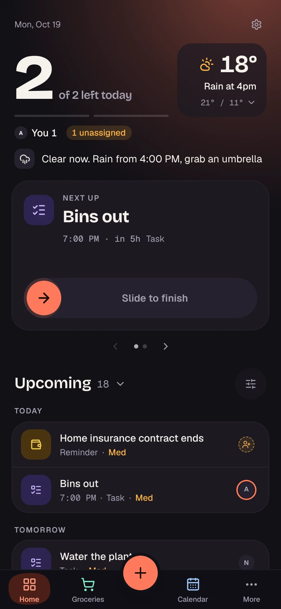
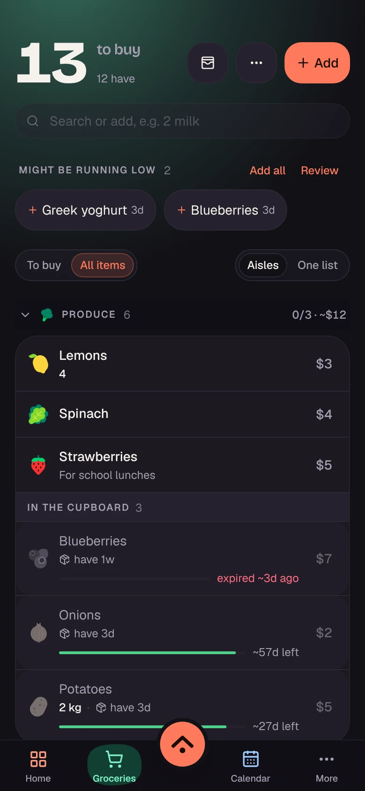
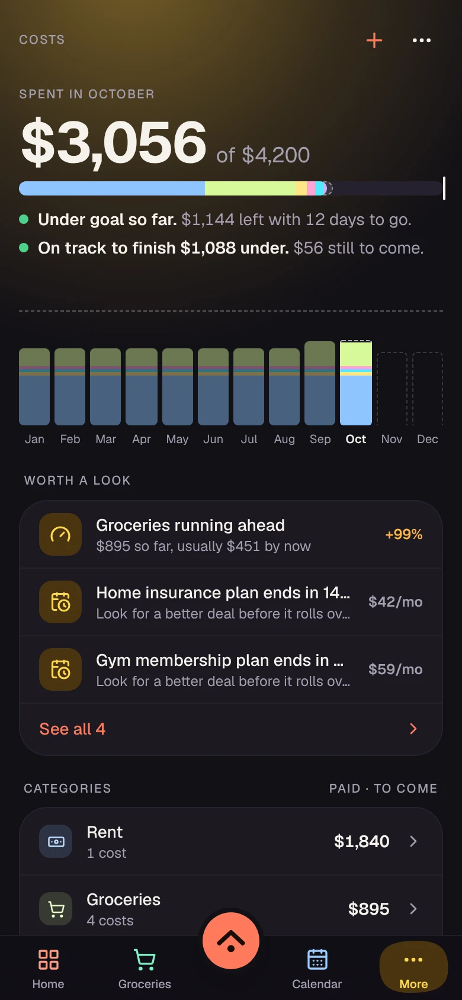
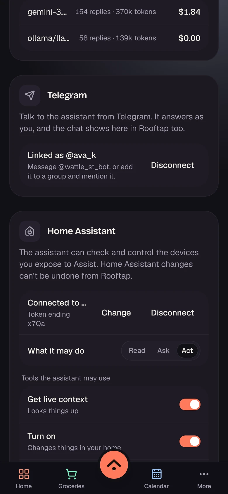
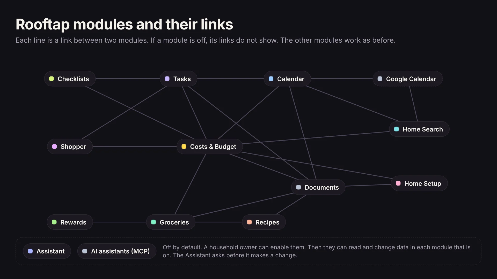

# Rooftap

[](LICENSE)

Rooftap is a household app. It holds shared tasks and chores, groceries, recipes, a family calendar, costs and a budget, loyalty cards and price tracking. An optional assistant can also talk to Home Assistant. Each household switches on only the modules it uses.

This repository has everything you need to run your own Rooftap server, so your household's data stays on your machine. Rooftap is source-available under the [Elastic License 2.0](#license). You can self-host it and change it, but you cannot offer it to others as a hosted service.

**[Try the demo](https://guybnd.github.io/rooftap/demo/?live=1&theme=ember-night)** (runs in your browser on sample data, no account) · [Website](https://guybnd.github.io/rooftap/) · [Android APK](https://github.com/guybnd/rooftap/releases)

<p>
  
  
  
  
</p>

## Modules



| Module | What it does |
| --- | --- |
| Tasks & Reminders | Shared to-dos, chores and reminders with due dates. |
| Calendar | Household events and everything with a date, in one view. Optional Google Calendar link: sends tasks and viewings there and shows your Google events. |
| Groceries | A shared shopping list with aisles and an item library. |
| Recipes | Your household recipes, with a cooking view. Add a recipe's ingredients to the list in one tap. |
| Checklists | Reusable lists and templates, from packing to cleaning. |
| Documents | Warranties, receipts and paperwork, filed in folders. |
| Costs & Budget | Bills, recurring costs and a monthly budget. |
| Rewards | Loyalty cards with a scannable barcode, the stores they work at, and their perks. |
| Shopper | Things you want to buy, with price tracking and a deal rating. |
| Home Setup | Rooms, purchases and the moving checklist for a new home. |
| Home Search | Listings, viewings, agents and a map while you look for a place. |
| Assistant | A household agent you can ask or talk to. It asks before it changes anything. It can use Home Assistant through HA's MCP Server integration, and you can talk to it from Telegram. Needs your own AI provider key. |
| AI assistants (MCP) | Lets an outside AI assistant, such as Claude, read and update your household through MCP. |

Everything works with no AI and no AI key. The Assistant and MCP modules stay off until a household owner turns them on.

### How the modules work together

Each module works alone. When two related modules are on, they link to each other. The screens show the demo data.


## Quick start

You need Docker with Docker Compose.

```bash
git clone <this repository> rooftap && cd rooftap
cp .env.example .env
./scripts/self-host-init.sh -d
```

The first run writes every secret into `.env`, builds the app, starts the stack and applies the database migrations. Back up `.env`. Then open http://localhost:3000. The first visit creates the owner account. After that, registration closes, and the owner adds household members in **Settings → Users**.

Everything else is optional. `.env.example` explains each setting:

- a [Mapbox token](https://account.mapbox.com/access-tokens/) for maps, geocoding and directions
- an OpenAI, Anthropic, Gemini or OpenRouter key for the AI features
- `HOMEUP_MODULES` to limit the modules that your server offers

The full guide covers HTTPS for the phone app, backups, upgrades and how to recover a locked-out owner: **[.docs/self-hosting.md](.docs/self-hosting.md)**.

## Phone app

Install the Android app from [Releases](https://github.com/guybnd/rooftap/releases) and point it at your server. Android release builds talk only to HTTPS servers. The easiest way is the bundled Tailscale Funnel or Cloudflare Tunnel profile: the phone needs nothing extra and your router needs no open ports. A public domain with the Caddy profile also works. "Mobile access" in the self-hosting guide has the steps.

## Web app (PWA)

The web app installs like an app on Android, iPhone, iPad and desktop. Open your server in the browser and choose **Install app** (Chrome, Edge) or **Add to Home Screen** (Safari). It opens in its own window and works offline. Browsers install only over HTTPS. Set up the same HTTPS address as for the phone app, set `NEXT_PUBLIC_SUPABASE_URL` to that `https://` address and rebuild. "Installing the web app (PWA)" in the self-hosting guide has the steps.

## What's in the stack

`docker-compose.yml` runs Postgres and the Supabase services (auth, REST, realtime, storage and edge functions) behind a Kong gateway, plus the Rooftap web app (Next.js). The server needs outbound internet access for public services such as Open-Meteo weather and the OpenStreetMap Overpass API.

## Known rough edges

- No iOS app yet. iPhone and iPad use the web app (PWA).
- The Android app is not on Google Play yet. Install the APK from [Releases](https://github.com/guybnd/rooftap/releases).
- No in-app account deletion yet.
- One maintainer reads every issue, but answers can take a few days.

## Development

```bash
npm ci
npm run check   # typecheck, lint and tests in every workspace
```

It is a Turborepo monorepo:

- `apps/web`: the Next.js web app and API routes
- `apps/mobile`: the Expo app
- `packages/core`: shared, platform-agnostic logic and data access
- `packages/ui`: shared React Native components
- `supabase/`: migrations and edge functions

Design and architecture notes are in [.docs/](.docs/INDEX.md).

## Contributing

This repository is a published snapshot of Rooftap's main development repository. Issues and pull requests are welcome here. We apply an accepted change upstream, and the next sync brings it back, so GitHub shows the PR as closed, not merged. [CONTRIBUTING.md](CONTRIBUTING.md) has the details.

Report security problems privately, as [SECURITY.md](SECURITY.md) says.

## License

[Elastic License 2.0](LICENSE). You can run, change and self-host Rooftap for yourself, your household or your organization. You cannot offer Rooftap to others as a hosted or managed service. ELv2 is a source-available license, not an OSI open-source license.
